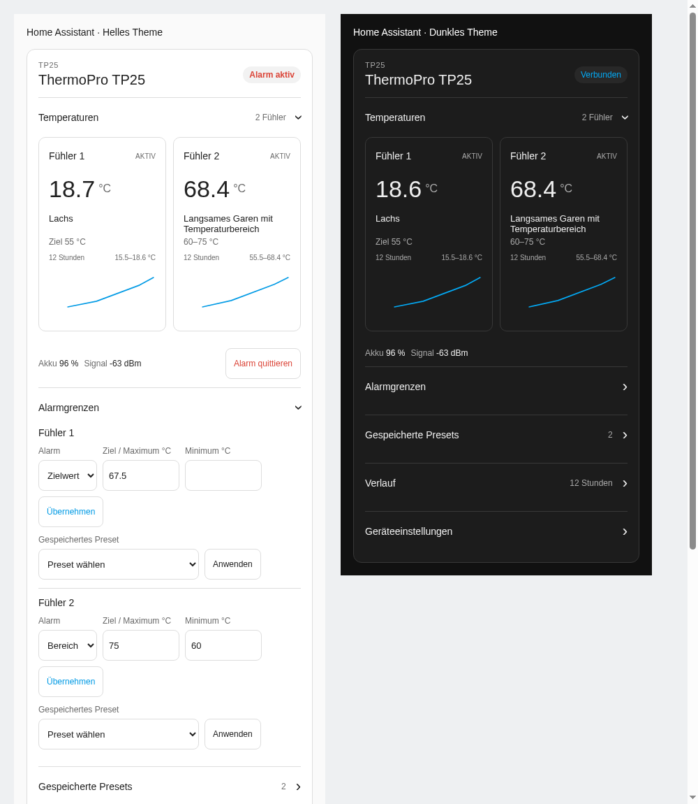

# ThermoPro thermometer card

Temperature readings, history, and device controls for Home Assistant dashboards.
Supports the `thermopro`, `tp90x_multi`, and `thermopro_meat` integrations.
Controls appear only when the selected integration provides them.

Version: **0.2.2**. Use resource version **22** after updating.



## Functions

- Show available temperature channels in boxes of equal height.
- Group TempSpike internal, ambient, and additional temperature positions by physical probe.
- Show the battery for each probe and humidity when exposed.
- Show a 12-hour temperature history from Home Assistant Recorder.
- Follow the HA unit, follow the device display unit, or use Celsius or Fahrenheit.
- Hide disconnected probes.
- Show battery and signal values when available.
- Show confirmed profile names and limits when available.
- Show only the controls that the selected device and integration supply.
- Use TP90x unit, sound, alarm-limit, alarm-enable, snooze, and backlight entities when present.
- Show the Core clock synchronization button when exposed.
- Keep form values and open sections during Home Assistant updates.

## Extended features with the TP25 custom integration

Use the **ThermoPro TP25 custom integration** to access the full TP25 controls in this card:

- Set a target temperature or an alarm range for each probe.
- Create, edit, save, and apply named alarm presets.
- Acknowledge device alarms.
- Change the device display unit and alarm sound setting.
- Pause and resume the Bluetooth connection.

These functions are provided by the custom integration; installing the card alone does not add them.
The extended feature set currently applies to **TP25**.
Support may expand to other models in the future, depending on integration support.
The card shows the controls available for the selected device and also works with temperature and battery entities alone.

## Installation

### HACS

Add this repository under **HACS → Custom repositories**, category **Dashboard**.
Install **ThermoPro Thermometer Card**.
If HACS does not register the resource, add `/hacsfiles/lovelace-thermopro-thermometer-card/thermopro-thermometer-card.js?version=22` as a JavaScript module.

### Manual installation

1. Find your Home Assistant configuration directory.
2. Make its `www` directory if necessary.
3. Copy `thermopro-thermometer-card.js` into that directory.
4. Open **Settings → Dashboards → Resources**.
5. Add `/local/thermopro-thermometer-card.js?version=22` as a JavaScript module.
6. Reload the dashboard.
7. Add this card:

```yaml
type: custom:thermopro-thermometer-card
```

If there is one ThermoPro device, the card selects it automatically.
If there are multiple devices, select one in the visual editor.
You can also use its unique device name:

```yaml
type: custom:thermopro-thermometer-card
device_name: ThermoPro TP25
```

Use `device_id` only when device names are not unique.
The value must be the Home Assistant device-registry ID.
Open the device under **Settings → Devices & services → Devices** and copy the ID after `/config/devices/device/` in the browser URL.
Supported registry platforms are `thermopro`, `tp90x_multi`, and `thermopro_meat`.
It is not the Bluetooth address.

## Choose the card language

The card and visual editor support English and German.
By default, both follow the Home Assistant user-interface language.
Regional variants such as `en-US` and `de-DE` use their base language.
Other languages fall back to English.

Use **Language** in the visual editor to override the automatic choice.
The corresponding field is **Sprache** in German.
The available configuration values are `auto`, `de`, and `en`.

```yaml
type: custom:thermopro-thermometer-card
language: en
```

A language change preserves open sections and current form drafts.
Preset names, entity IDs, device names, and service values remain unchanged.
Messages returned by other integrations retain their original text.
The card language does not change the device unit or HA temperature settings.

## Choose the displayed temperature unit

Use **Temperature display** in the visual card editor.
The available values are:

| Configuration value | Behavior |
| --- | --- |
| `ha` | Use the HA entity unit. This is the default. |
| `device` | Follow the reported device display unit. Fall back to the HA unit if it is unknown. |
| `celsius` | Convert the displayed temperatures to Celsius. |
| `fahrenheit` | Convert the displayed temperatures to Fahrenheit. |

For example:

```yaml
type: custom:thermopro-thermometer-card
temperature_unit: device
```

The choice changes readings, history, and the profile summary in the card.
History points retain their original units before display conversion.
The card does not change the device display or the HA sensor unit.
The `device` option requires a reported device unit; otherwise it uses the HA entity unit.
TP25 alarm fields and the preset editor use Celsius values.
TP90x limit fields use each number entity's reported unit, including Fahrenheit.
The card sends the entered value without a second conversion.

## Use profiles and alarms

TP25 profile controls require the TP25 custom integration.
TP90x uses its existing number and switch entities instead.
An enabled alarm is a configuration state, not proof of an active alarm.
An active-alarm indicator requires an alarm-state entity.
TP25 profile limits use Celsius, regardless of the displayed measurement unit.
A preset name is active only when its limits match the confirmed device profile.

### Manage presets

Open **Presets** to create, edit, or delete named templates.
Choose **Apply preset** in the probe alarm section to apply a saved template.
The custom integration stores templates in Home Assistant, independently of this card.
They survive dashboard changes and Home Assistant restarts.
No named templates are installed by default.

The device page preset selects can apply existing templates, but cannot create or delete them.
The integration actions also manage presets without this card.
See the custom integration README for `thermopro.save_alarm_preset` and `thermopro.delete_alarm_preset`.
Saving or deleting a template does not change an active device profile.
Apply the template again after editing its limits.
Preset management requires the TP25 custom integration.

### Acknowledge alarms

Alarm acknowledgement affects all TP25 probes.
The device report supplies the actual alarm state after acknowledgement.
Pending controls remain disabled until their action finishes.

History requires Recorder data for the temperature entities.
A separate optional Home Assistant timer is not a TP25 firmware timer.

## Compatibility

The card reads Home Assistant entities. The installed integration supplies Bluetooth device support.

**Automated tests** use simulated HA entities.
**Device tested** means the card was used with a physical thermometer.
Only TP25 has been tested with hardware; the other models need confirmation from their owners.

| Model | HA integration | Should be compatible | Automated tests | Device tested |
| --- | --- | --- | --- | --- |
| TP25 | TP25 custom integration | Yes, with TP25 controls | Yes | Yes |
| TP25 | Proposed Core TP25 support (not released) | Yes, basic readings | Yes | Yes, test build |
| TP357 | Core `thermopro` | Yes | Yes | No |
| TP357S | Core `thermopro` | Yes | Yes | No |
| TP358 | Core `thermopro` | Yes | Yes | No |
| TP358S | Core `thermopro` | Yes | Yes | No |
| TP359 | Core `thermopro` | Yes | Yes | No |
| TP393 | Core `thermopro` | Yes | Yes | No |
| TP960 / TP960R | Core `thermopro` | Yes | Yes | No |
| TP962 / TP962R | Core `thermopro` | Yes | Yes | No |
| TP970 / TP970R | Core `thermopro` | Yes | Yes | No |
| TP972S | Core `thermopro`, if exposed by the installed HA version | Yes | Yes | No |
| TP902 | Custom `tp90x_multi` | Yes, with exposed controls | Yes | No |
| TP920 | Custom `tp90x_multi` | Yes, with exposed controls | Yes | No |
| TP904 | Custom `tp90x_multi`, experimental device support upstream | Yes, with exposed controls | Yes | No |
| TP902 | Custom `thermopro_meat` | Yes, basic readings | Yes | No |

The device must work with one of the supported integrations before it can appear in the card.
Unsupported controls and TP25-only presets remain hidden for other providers.
Disabled entities are not included; enable them in HA and reload the card when needed.
Enable the battery entity if your integration disables it by default.
Passive Core sensors show data availability rather than claiming an active Bluetooth connection.

## Development

Run `npm test` for unit tests.
Open the HTML fixtures in `tests/` for browser layout, language, and interaction checks.
These fixtures use synthetic HA states.

See [CHANGELOG.md](CHANGELOG.md) for changes.
Entity roles use stable unique IDs, so translated and renamed entities keep their controls.
